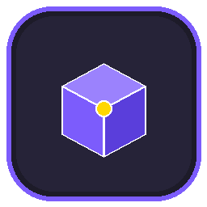
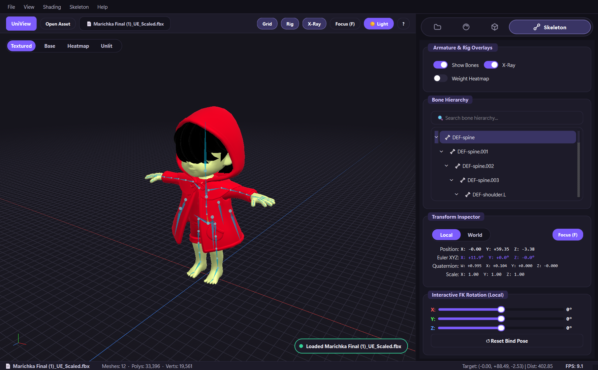
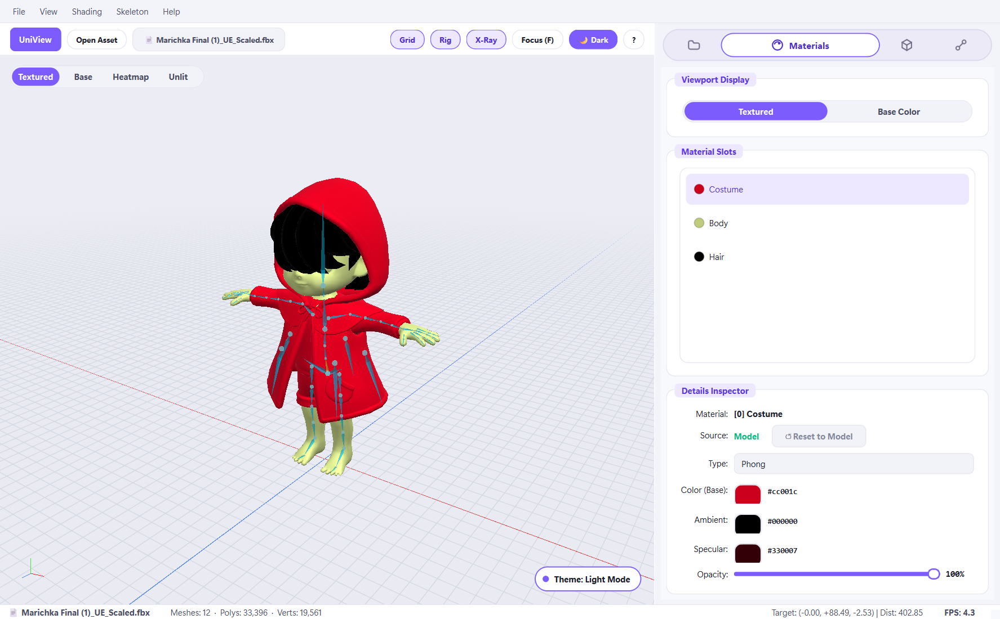

<div align="center">

  

  # UniView 2.0

  **Next-Gen Minimalist 3D Asset & Rig Visualizer with Expanding Label Navigation**

  <p align="center">
    <a href="https://www.python.org/downloads/"></a>
    <a href="https://www.python.org/"></a>
    <a href="https://www.qt.io/"></a>
    <a href="https://github.com/moderngl/moderngl"></a>
    <a href="LICENSE"></a>
  </p>

  <p align="center">
    <a href="#overview">Overview</a> •
    <a href="#preview">Preview</a> •
    <a href="#key-features">Key Features</a> •
    <a href="#keyboard-shortcuts">Shortcuts</a> •
    <a href="#getting-started">Getting Started</a> •
    <a href="#supported-formats">Supported Formats</a>
  </p>

</div>

---

## 🔍 Overview

**UniView** is an ultra-responsive, lightweight desktop 3D model and skeletal rig visualizer crafted for 3D artists, animators, and game developers. Traditional 3D suites like Blender or Maya are often too heavy when you just want to quickly inspect an asset's hierarchy, check for missing texture maps, preview bone deformations, or review vertex weight distributions.

UniView solves this by providing a clean, distraction-free environment:
- **Instant Asset Inspection**: Open FBX, glTF/GLB, and OBJ files in seconds without complex scene setup.
- **Juicy Minimalist Design**: Powered by custom vector widgets, 60 FPS animated pill transitions, and real-time Dark/Light theme switching.
- **Direct Rig Interaction**: Forward Kinematics (FK) rotation sliders and bone hierarchy inspection make verifying joint orientations and bind poses straightforward.
- **Smart Dependency Resolving**: Automatically analyzes missing image textures, allows drag-and-drop replacement directly onto tree rows, or resolves entire asset libraries via a one-click folder scan.

---

## 🖼️ Preview

<div align="center">

| Obsidian Dark Studio | Alabaster Light Studio |
| :---: | :---: |
|  |  |

</div>

---

## 🚀 Key Features

### 🌟 Minimalist "Juicy Simple" UI
- **Dual Studio Themes**: Seamlessly switch between **Obsidian Dark** (`#111018`) and **Alabaster Light** (`#F3F4F9`) with `Ctrl+T`.
- **Expanding Label Stadium Bar**: The active inspector tab grows into an accent pill while its label smoothly slides out at 60 FPS, shrinking inactive tabs to clean monoline vector icons.
- **Floating Shading HUD**: A semi-transparent floating pill bar sits right on the 3D viewport for instant shading swaps (*Textured*, *Base Color*, *Heatmap*, *Unlit*).
- **Responsive Micro-Feedback**: Floating toast notifications keep you informed of actions (e.g., *"Loaded character.fbx"*, *"Texture relinked"*, *"Bind pose restored"*).
- **Drag-and-Drop Viewport**: Drag any 3D asset over the viewport to trigger a sleek dashed overlay card for immediate loading.

### 📐 High-Performance 3D Engine
- **ModernGL & Arcball Camera**: Smooth, hardware-accelerated OpenGL 3.3+ rendering with intuitive Orbit, Pan, and Zoom controls.
- **Standard 3D Artist Focus (`F`)**: Press `F` or double-click any sub-mesh, bone, or material to instantly zoom and center the camera on it without toggling visibility.
- **Frame-Rate Throttling**: Status bar camera coordinate emission is throttled (~12 Hz) to prevent Qt layout overhead during rapid 60 FPS camera rotation.

### 🎛️ Four Dedicated Inspector Panels
1. **📁 Files (Dependency Analyzer)**:
   - Categorizes assets into *Missing Files* and *Available Files*.
   - Drag & drop image files (`.png`, `.jpg`, `.tga`, `.dds`, etc.) directly onto missing texture rows to re-bind them dynamically into OpenGL memory.
   - Batch **Scan Folder** to auto-match and relink missing textures from any directory in one click.
2. **🎨 Materials (PBR & Shading Inspector)**:
   - Live color swatch pill buttons with hexadecimal readouts and real-time color dialogs.
   - Opacity slider and instant shading mode controls.
3. **📦 Meshes (Sub-Mesh Node Explorer)**:
   - Tree list of all individual sub-meshes with face and vertex count readouts.
   - Real-time search filter.
   - Custom vector action icons: **Isolate** (`⛶`) to frame and focus a single sub-mesh, and **Eye** (`👁`) to toggle individual visibility.
4. **🦴 Skeleton (Rig & Armature Inspector)**:
   - Full parent-child bone hierarchy tree with instant search.
   - **X-Ray Overlay**: View bones through mesh geometry.
   - **Vertex Weight Heatmap**: Colorizes mesh vertices based on active bone influence (Blue $\rightarrow$ Cyan $\rightarrow$ Green $\rightarrow$ Yellow $\rightarrow$ Red).
   - **Transform Inspector**: Readout of Position, Euler XYZ, Quaternion, and Scale in both Local and World space.
   - **Interactive FK Rotation Sliders**: Test joint rotations on X/Y/Z axes (-180° to +180°) with live deformation and a 1-click **Reset Bind Pose** (`Ctrl+R`).

---

## ⌨️ Keyboard Shortcuts

| Shortcut | Action |
| :--- | :--- |
| **LMB Drag** | Orbit camera around target |
| **RMB / MMB Drag** | Pan camera target |
| **Mouse Wheel** | Smooth zoom in / out |
| **`F` / Double Click** | Focus camera on selected bone, sub-mesh, or material |
| **`A` / `Shift+F`** | Frame entire 3D model |
| **`Home`** | Reset camera to initial framing position |
| **`1` · `2` · `3` · `4`** | Shading modes: *Textured*, *Base Color*, *Heatmap*, *Unlit* |
| **`G`** | Toggle Ground Grid |
| **`B`** | Toggle Skeleton Bones overlay |
| **`X`** | Toggle Skeleton X-Ray mode |
| **`Ctrl + R`** | Reset Skeleton bind pose |
| **`Ctrl + T`** | Toggle Dark / Light theme |
| **`Ctrl + O`** | Open 3D asset file |
| **`F1` / `?`** | Open Keyboard Shortcuts cheat-sheet |
| **`F11`** | Toggle Fullscreen |

---

## 🛠️ Getting Started

### Prerequisites
- Python 3.10 or higher
- C++ Assimp runtime (required for `pyassimp`)

Using Conda (Recommended):
```bash
conda create -n uniview python=3.10 -y
conda activate uniview
conda install -c conda-forge assimp=5.4.3 -y
```

### Installation
```bash
# Clone the repository
git clone https://github.com/your-username/UniView.git
cd UniView

# Install Python requirements
pip install -r requirements.txt
```

### Launching UniView
```bash
# Launch default viewer
python main.py

# Launch directly with a specific 3D model
python main.py "path/to/character.fbx"
```

> **Windows Desktop Shortcut**: You can run `create_desktop_shortcut.bat` to place a one-click shortcut directly on your Windows desktop.

---

## 📦 Supported Formats

| Format | Extensions | Capabilities |
| :--- | :--- | :--- |
| **Autodesk FBX** | `.fbx` | Skeletal rigs, bone hierarchies, materials, skins |
| **glTF 2.0** | `.gltf`, `.glb` | PBR material definitions, skeletal animations |
| **Wavefront OBJ** | `.obj`, `.mtl` | Multi-mesh geometry, diffuse textures, groups |
| **Collada** | `.dae` | Hierarchical nodes, static/skinned meshes |
| **Standard Mesh** | `.stl`, `.ply`, `.3ds`, `.off` | Polygon geometries, CAD/3D print models |

---

## 📜 License

Distributed under the **MIT License**. See [`LICENSE`](LICENSE) for more information.
